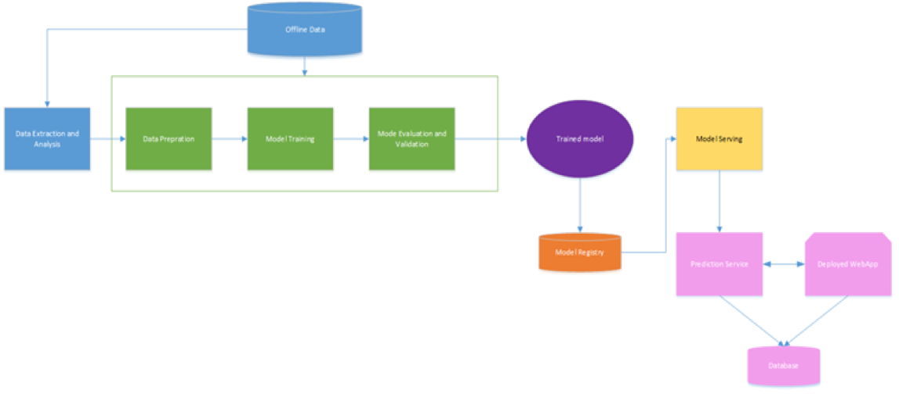
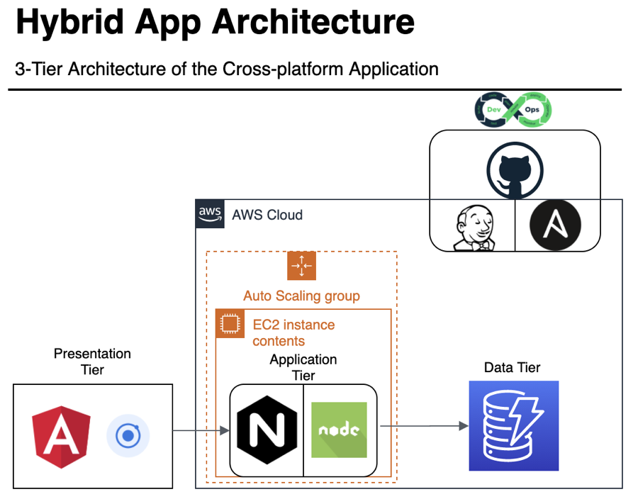
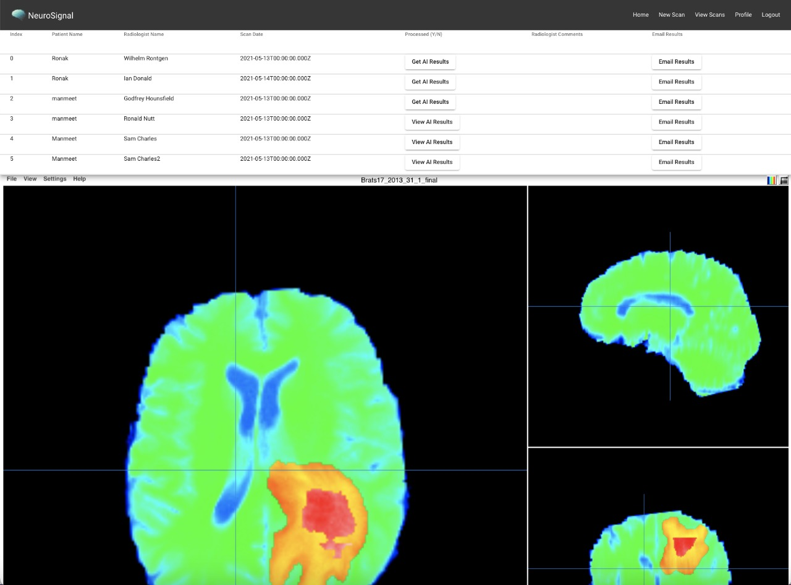

# Brain Tumor Anomaly Detection and 3D Segmentation using Multimodal Brain MRI Data

A Master's project combining unsupervised deep learning for anomaly detection with supervised 3D segmentation to help radiologists triage and localize brain tumors from MRI scans.

**San Jose State University** — Data Science Program
Advisor: [Vijay Eranti](https://www.linkedin.com/in/vijay-eranti-6a6485/)

**Team:** [Asha Aher](https://www.linkedin.com/in/asha-aher) · [Chinmay Vadgama](https://www.linkedin.com/in/chinmayvadgama/) · [Manmeet Singh](https://www.linkedin.com/in/msingh16/) · [Ronak Mehta](https://www.linkedin.com/in/ronakmehta21/)

Full write-up: [Report.pdf](documents/Report.pdf) · [Poster-Board.pdf](documents/Poster-Board.pdf)

---

## Table of Contents
- [Overview](#overview)
- [Approach](#approach)
- [System Architecture](#system-architecture)
- [Repository Structure](#repository-structure)
- [Getting Started](#getting-started)
- [Reference Papers](#reference-papers)

## Overview

Quantitative analysis of brain MRI is central to routine screening and treatment planning, but manual review is slow and depends on radiologist availability. Unsupervised deep learning offers a way to flag abnormal scans automatically: by learning what a *healthy* brain looks like, a model can detect deviations from that norm without ever being trained on labeled tumors.

This project builds on that idea in two stages:

1. **Anomaly detection** — a Generative Adversarial Network (GAN) is trained exclusively on healthy brain MRI so it learns to reconstruct normal anatomy. At inference time, regions the model reconstructs poorly correspond to abnormal tissue, giving a first-pass signal for "does this scan need a closer look?"
2. **Tumor segmentation** — for scans flagged as abnormal, a 3D U-Net segmentation model (trained on the BraTS dataset) localizes and delineates the tumor sub-regions (whole tumor, tumor core, enhancing core), giving a radiologist a concrete region of interest rather than a single anomaly score.

Together, these give a preliminary diagnostic pipeline: **flag → localize → review**, exposed to end users through a web application where technicians upload scans and radiologists confirm or override the model's output.

## Approach

We evaluated three GAN-based anomaly detection architectures on brain MRI before finalizing the pipeline:

| Component | Technique | Purpose |
|---|---|---|
| [`anogan/`](anogan) | f-AnoGAN (WGAN + encoder) | Primary anomaly detection model — fast inference via a learned encoder into GAN latent space |
| [`baselines/ganomaly/`](baselines/ganomaly) | GANomaly | Baseline semi-supervised anomaly detector, used for comparison |
| [`notebooks/`](notebooks) | Data prep, GANomaly (TF2), exploratory training | OASIS-3 / Kaggle experimentation and preprocessing pipelines used to reach the above |
| [`unet_3d_segmentation/`](unet_3d_segmentation) | 3D U-Net (cascaded, anisotropic) | Downstream tumor segmentation on BraTS once a scan is flagged abnormal |
| [`webapp/`](webapp) | Angular/Ionic + Node.js/Express | End-user platform: upload, view, and review MRI results |

Each subfolder above has its own README with setup and usage instructions.

## System Architecture

**Application architecture** (model pipeline: upload → anomaly detection → segmentation → review):



**Web platform architecture** (frontend/backend/storage):



**Web platform screenshot:**



## Repository Structure

```
.
├── anogan/                  # f-AnoGAN anomaly detection model (TensorFlow)
├── baselines/                # GANomaly baseline + early WGAN-GP/OASIS-3 experiments
│   └── ganomaly/
├── notebooks/                 # Colab notebooks: data prep, training, evaluation
│   ├── AnomalyDetection/
│   ├── data_preprocessing/
│   └── TumorSegmentation/
├── unet_3d_segmentation/    # 3D U-Net tumor segmentation on BraTS
├── webapp/                  # End-user web platform
│   ├── backend/              # Node.js / Express API
│   └── frontend/             # Angular / Ionic client
└── documents/                # Final report, poster, and reference papers
    ├── assets/                # Architecture diagrams & screenshots used in this README
    └── papers/
```

## Getting Started

Each component is trained/served independently — see its README for exact steps:

- **Anomaly detection (f-AnoGAN):** [`anogan/README.md`](anogan/README.md)
- **Anomaly detection baseline (GANomaly):** [`baselines/ganomaly/README.md`](baselines/ganomaly/README.md)
- **Tumor segmentation (3D U-Net / BraTS):** [`unet_3d_segmentation/README.md`](unet_3d_segmentation/README.md)
- **Web platform:** [`webapp/README.md`](webapp/README.md)
- **Notebooks (data prep & experimentation):** [`notebooks/README.md`](notebooks/README.md)

General prerequisites:
- A CUDA-capable GPU for training or inference
- Docker (used for the segmentation inference container)

## Reference Papers

Copies of the primary references are collected in [`documents/papers/`](documents/papers):
- Schlegl et al., *f-AnoGAN: Fast unsupervised anomaly detection with generative adversarial networks* (2019)
- Akcay et al., *GANomaly: Semi-Supervised Anomaly Detection via Adversarial Training* (2018)
- Wang et al., *Automatic Brain Tumor Segmentation using Cascaded Anisotropic Convolutional Neural Networks* (2018)

External resources used during development:
- [Brain MRI data visualization + U-Net/FPN (Kaggle)](https://www.kaggle.com/bonhart/brain-mri-data-visualization-unet-fpn)
- [PyTorch Hub — Brain Segmentation U-Net](https://pytorch.org/hub/mateuszbuda_brain-segmentation-pytorch_unet/)
- [BraTS 2017 Challenge](https://www.med.upenn.edu/sbia/brats2017.html)
